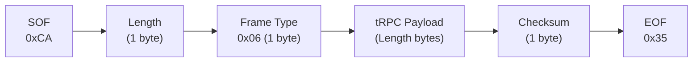
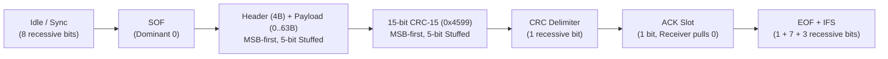

<!-- markdownlint-disable MD013 MD033 -->

# Tekmar 482 Gateway Protocol Specification

This document specifies the serial host protocol (**tPCK / tRPC / tHA**) and the internal multi-bus communication protocol (**tekmarNet4 / tN4**) used by the **Tekmar 482 Home Automation Gateway** (Protocol Version 3).

---

## 1. Overview & Serial Interface

The Tekmar 482 Gateway bridges an RS-232 host interface to up to five independent **tekmarNet (tN4 / tN2)** communication buses, supporting up to **120 devices** across all buses.

| Parameter | Value |
| :--- | :--- |
| **Host Interface** | RS-232 (3-wire: TXD, RXD, GND) |
| **Serial Configuration** | **9600 bps, 8 data bits, No parity, 1 stop bit (8N1)**, no flow control |
| **Byte Order (tRPC / tHA)** | Little-Endian (`uint16 LE`, `uint32 LE`) |
| **Protocol Version** | `3` (`0x0003`) |
| **Maximum Managed Devices** | `120` devices across 5 buses (1 Boiler bus + 4 Zone/Mixing buses) |
| **Setpoint / Scene Groups** | `12` groups (`1..12`) |

### Protocol Stack Architecture

1. **Data Link Layer (`tPCK`)**: Byte-stuffed framing (`0xCA` SOF, `0x35` EOF, `0x2F` Escape) with length, frame type (`0x06`), and an 8-bit modular checksum.
2. **Remote Procedure Call Layer (`tRPC`)**: 5-byte header specifying a 1-byte `ServiceID` (`0x00`–`0x04`) and a 32-bit Little-Endian `MethodID`.
3. **Application Layer (`tHA` — Tekmar Home Automation)**: 28 method definitions providing device discovery, capability querying, temperature/humidity sensing, setpoint/mode control, and unsolicited event reporting.
4. **Field Bus Layer (`tN4` — tekmarNet4)**: 400 bps CSMA/CD multi-drop bus protocol using 5-bit opposite-polarity bit-stuffing, a 32-bit Big-Endian packet header, and a 15-bit CAN CRC (`0x4599`).

---

## 2. Data Link Layer (`tPCK` Framing, Byte-Stuffing & Checksum)

All RS-232 serial communication between the host and the 482 gateway uses byte-stuffed `tPCK` frames:



### 2.1. Control Bytes & Escape Rules

- **Start of Frame (`SOF`)**: `0xCA`
- **End of Frame (`EOF`)**: `0x35`
- **Escape (`ESC`)**: `0x2F`

> [!IMPORTANT]
> **Byte-Stuffing Rule**: Any byte between `SOF` and `EOF` (including `Length`, `Frame Type`, `tRPC Payload`, and `Checksum`) whose value equals `0xCA`, `0x35`, or `0x2F` must be escaped on the wire by prefixing it with `0x2F` **without modifying the escaped byte**:
>
> - `0xCA` $\rightarrow$ `0x2F 0xCA`
> - `0x35` $\rightarrow$ `0x2F 0x35`
> - `0x2F` $\rightarrow$ `0x2F 0x2F`
>
> If an unescaped `0xCA` (`SOF`) is received mid-frame, the receiver immediately discards the partial frame and begins a new frame. Likewise, if the byte immediately following `Checksum` is not an unescaped `0x35` (`EOF`), the frame is discarded as malformed.

### 2.2. Un-escaped Frame Fields

1. **`Length` (`uint8`)**: Number of un-escaped bytes in `tRPC Payload` (`5 + data_length`). Valid `tRPC` payload length is `5..133` bytes (`5`-byte `tRPC` header plus `0..128` `Data` bytes; payloads larger than `133` bytes are invalid).
2. **`Frame Type` (`uint8`)**: Always **`0x06`** (`TYPE_TRPC`) for tRPC/tHA frames.
3. **`tRPC Payload` (`Length` bytes)**: The 5-byte tRPC header followed by `0..128` method argument bytes.
4. **`Checksum` (`uint8`)**: 8-bit unsigned modular sum of the **un-escaped** `Length`, `Frame Type`, and all `tRPC Payload` bytes:
   $$\text{Checksum} = \left(\text{Length} + \text{FrameType} + \sum_{i=0}^{\text{Length}-1} \text{Payload}[i]\right) \bmod 256$$

---

## 3. Tekmar RPC Layer (`tRPC`)

Inside a `Frame Type = 0x06` packet, the payload begins with a 5-byte header followed by method-specific parameters:

| Payload Offset | Size | Type | Field | Description |
| :--- | :--- | :--- | :--- | :--- |
| `+0` | 1 byte | `uint8` | `ServiceID` | Operation / service type (`0x00`–`0x04`, see table below) |
| `+1..+4` | 4 bytes | `uint32 LE` | `MethodID` | 32-bit Little-Endian Method ID (`0x00000000`, `0x00000107`–`0x000001A7`) |
| `+5..+(4+N)` | $N$ bytes (`0..128`) | `uint8[N]` | `Data` | Method parameters (`0..128` bytes max; all multi-byte integers are Little-Endian) |

### `ServiceID` Values (`Byte 0` of tRPC Payload)

| `ServiceID` | Name | Direction | Description |
| :--- | :--- | :--- | :--- |
| **`0x00`** | `Update` | Host $\rightarrow$ Gateway | Writes a setting or triggers an action; gateway replies with `Response:Update` (`0x03`) |
| **`0x01`** | `Request` | Host $\rightarrow$ Gateway | Queries current state/value; gateway replies with `Response:Request` (`0x04`) |
| **`0x02`** | `Report` | Gateway $\rightarrow$ Host | Unsolicited state-change event sent when `ReportingState` (`0x010F`) is enabled (`1`), except `TakingAddress` (`0x015F`) which may be sent even when `ReportingState` is disabled (`0`) |
| **`0x03`** | `Response:Update` | Gateway $\rightarrow$ Host | Confirmation response to an `Update` (`0x00`) request |
| **`0x04`** | `Response:Request` | Gateway $\rightarrow$ Host | Data response to a `Request` (`0x01`) query |

---

## 4. Common Data Types & Encodings

### 4.1. Device Address (`address`, `uint16 LE`)

Every tN4/tN2 device on the gateway is addressed by a 4-digit decimal (`PBNN`) 16-bit integer encoding its physical gateway port, system-controller bus, and device node number:

$$\text{address} = (1000 \times \text{Port}) + (100 \times \text{Bus}) + \text{Node}$$

| Component | Extraction Formula | Valid Range | Meaning |
| :--- | :--- | :--- | :--- |
| **`Port` (`P`)** | `address // 1000` | `0..4` | Physical gateway port (`0` = Boiler port `b`, `1..4` = Zone/Mixing ports `1..4`) |
| **`Bus` (`B`)** | `(address % 1000) // 100` | `0..7` | System-controller bus (`0` for standalone/zone port, or system-controller bus `0..7`) |
| **`Node` (`NN`)** | `address % 100` | `1..24` | Device node (`01..24`), related to the 6-bit tN4 `NodeID` (`1..24`) by $\text{Node} = 25 - \text{NodeID}$ |

- **Example**: Device node `01` on physical Port `1`, Bus `0` has `address = 1001` (`0x03E9`); on Port `1`, system-controller Bus `2`, Node `01` has `address = 1201` (`0x04B1`).
- **Invalid / Not Applicable**: `0xFFFF` (`NA_16`).

### 4.2. Temperature Encodings (`degH` and `degE`)

The gateway uses two temperature formats depending on the method:

1. **16-bit High-Resolution Temperature (`degH`, `uint16 LE`, tenths of a degree Fahrenheit with `+850` offset)**:
   - Used by `OutdoorTemperature` (`0x0117`), `CurrentTemperature` (`0x0137`), `CurrentFloorTemperature` (`0x0138`), and `SetpointDevice` (`0x013E`).
   - Encoded in **tenths of a degree Fahrenheit ($0.1\,^\circ\text{F}$) offset by $+850$** (e.g., $0 = -85.0\,^\circ\text{F}$, $1350 = 50.0\,^\circ\text{F}$):
     $$\text{degH} = \text{round}\big((10 \times T_{^\circ\text{F}}) + 850\big), \qquad T_{^\circ\text{F}} = \frac{\text{degH} - 850}{10.0}, \qquad T_{^\circ\text{C}} = \frac{T_{^\circ\text{F}} - 32}{1.8}$$
   - Unavailable or sensor error is represented as **`0xFFFF`** (`NA_16`).

2. **8-bit Setpoint Temperature (`degE`, `uint8`, half-degrees Celsius)**:
   - Used by `HeatSetpoint` (`0x013F`), `CoolSetpoint` (`0x0147`), and `SlabSetpoint` (`0x014F`).
   - Encoded in **half-degrees Celsius ($0.5\,^\circ\text{C}$)**:
     $$\text{degE} = \text{round}(T_{^\circ\text{C}} \times 2), \qquad T_{^\circ\text{C}} = \frac{\text{degE}}{2.0}$$
   - `0x00` (`0.0 °C`) represents `Off` for slab/setpoint targets; **`0xFF`** (`NA_8`) indicates unavailable/unsupported.

### 4.3. Setback / Schedule Index (`setback`, `uint8`)

Used in setpoint and fan percent methods (`0x013E`, `0x013F`, `0x0147`, `0x014F`, `0x0157`, `0x0177`):

| Value | Name (`ThaSetback`) | Schedule Slot Mapping | Description |
| :--- | :--- | :--- | :--- |
| **`0x00`** | `WAKE_4` | Occupied / Day | 4-event schedule: Wake (Occupied 1) |
| **`0x01`** | `UNOCC_4` | Unoccupied / Night | 4-event schedule: Leave (Unoccupied 1) |
| **`0x02`** | `OCC_4` | Occupied / Day | 4-event schedule: Return (Occupied 2) |
| **`0x03`** | `SLEEP_4` | Unoccupied / Night | 4-event schedule: Sleep (Unoccupied 2) |
| **`0x04`** | `OCC_2` | Occupied / Day | 2-event schedule: Occupied (Day) |
| **`0x05`** | `UNOCC_2` | Unoccupied / Night | 2-event schedule: Unoccupied (Night) |
| **`0x06`** | `AWAY` | Away / Vacation | Away / Permanent Hold |
| **`0x07`** | `CURRENT` | *(Device's active slot)* | Queries or updates whichever setback state is currently active on the device |

> [!NOTE]
> Setback states `0, 2, 4` share the **Occupied (Day)** setpoint storage slot, `1, 3, 5` share the **Unoccupied (Night)** slot, and `6` uses the **Away** slot. When **`SetbackEnable` (`0x016F`)** is `0` (Disabled), writing a setpoint updates all schedule slots simultaneously.

### 4.4. Schedule Events Count (`events`, `uint8`, Method `0x017F`)

Reported by `SetbackEvents` (`0x017F`):

- `0x00` = No schedule (`0` events)
- `0x01` = 2-event schedule (`OCC_2` / `UNOCC_2`)
- `0x02` = 4-event schedule (`WAKE_4` / `UNOCC_4` / `OCC_4` / `SLEEP_4`)

### 4.5. Device Operating Mode (`mode`, `uint8`, Method `0x0127`)

Used by `ModeSetting` (`0x0127`):

- `0x00` = `OFF`
- `0x01` = `HEAT`
- `0x02` = `AUTO`
- `0x03` = `COOL`
- `0x04` = `VENT` (Fan Only)
- `0x06` = `EMERGENCY` (Auxiliary / Emergency Heat)
- `0xFF` = `NA_8` (Unavailable / Not supported)

### 4.6. Active Demand (`demand`, `uint8`, Method `0x012F`)

Reported by `ActiveDemand` (`0x012F`):

- `0x00` = `IDLE` (No active demand)
- `0x01` = `HEAT` (Heating / Melt demand active)
- `0x03` = `COOL` (Cooling demand active)

### 4.7. Device Attributes / Capabilities Bitmask (`attributes`, `uint16 LE`, Method `0x011F`)

Returned by `DeviceAttributes` (`0x011F`) to indicate which features and sensors are active on a device:

| Bit | Mask | Field Name | Capability / Feature |
| :--- | :--- | :--- | :--- |
| **Bit 0** | `0x0001` | `ZoneHeating` | Supports 8-bit **Heat Setpoint** (`0x013F`). *(Note: Cleared on Floor-Only thermostats where Bit 2 is set.)* |
| **Bit 1** | `0x0002` | `ZoneCooling` | Supports 8-bit **Cool Setpoint** (`0x0147`). |
| **Bit 2** | `0x0004` | `SlabSetpoint` | **Floor-Only Sensor Mode**: Both `CurrentTemperature` (`0x0137`) and `CurrentFloorTemperature` (`0x0138`) report the floor sensor; supports `SlabSetpoint` (`0x014F`). |
| **Bit 3** | `0x0008` | `FanPercent` | Supports **Fan Mode / Percent** (`0x0157`). |
| **Bit 4** | `0x0010` | `RelativeHumidity` | Supports **Relative Humidity Sensor** (`0x0150`). |
| **Bit 5** | `0x0020` | `HumiditySetMax` | Supports **Humidity Maximum Setpoint** (`0x0151`, Dehumidify). |
| **Bit 6** | `0x0040` | `HumiditySetMin` | Supports **Humidity Minimum Setpoint** (`0x0152`, Humidify). |
| **Bit 7** | `0x0080` | `SetpointDevice` | Supports **16-bit Setpoint (`0x013E`)** and **Mode Setting (`0x0127`)** (e.g., Setpoint Control 161). |
| **Bit 8** | `0x0100` | `RoomAndSlab` | **Room + Floor Sensor Mode**: Thermostat has both an air sensor (`0x0137`) and a floor/slab sensor (`0x0138`) with `SlabSetpoint` (`0x014F`). |

> [!TIP]
> **Floor Temperature & Slab Setpoint Availability**: A thermostat supports `CurrentFloorTemperature` (`0x0138`) and `SlabSetpoint` (`0x014F`) when **either** `SlabSetpoint` (Bit 2, `0x0004`) **or** `RoomAndSlab` (Bit 8, `0x0100`) is set (`(attributes & 0x0104) != 0`). Because device capabilities are discovered asynchronously over the 400 bps tN4 bus, the gateway may emit unsolicited `Report` (`0x02`) packets for `DeviceAttributes` (`0x011F`) after initial discovery.

---

## 5. Complete tHA Method Reference

The gateway implements **28 Method IDs**:

| Method ID | Dec | Method Name | Services (`ServiceID`) | Request / Update `Data` (Host $\rightarrow$ GW) | Response / Report `Data` (GW $\rightarrow$ Host) |
| :--- | :--- | :--- | :--- | :--- | :--- |
| **`0x00000000`** | 0 | `NullMethod` | `0, 1` $\rightarrow$ `3, 4` | *Empty (0 bytes)* (or any unrecognized Method ID) | *Empty (0 bytes)* |
| **`0x00000107`** | 263 | `NetworkError` | `0, 1, 2` | `Request (1)` or `Update (0)`: *0 bytes* | `uint16 LE error` (Low byte = error code; `0x0000` = No errors) |
| **`0x0000010F`** | 271 | `ReportingState` | `0, 1, 2` | `Request (1)`: *0 bytes*<br/>`Update (0)`: `uint8 state` (`0`=Off, `1`=On) | `uint8 state` (`0` or `1`) |
| **`0x00000117`** | 279 | `OutdoorTemperature` | `0, 1, 2` | `Request (1)`: *0 bytes*<br/>`Update (0)`: `uint16 LE temp` (`degH`, $< 3050$, or $\ge 3050$ to clear) | `uint16 LE temp` (`degH`, `0xFFFF` if unavailable) |
| **`0x0000011F`** | 287 | `DeviceAttributes` | `0, 1, 2` | `uint16 LE address` (2 bytes) | `uint16 LE address` + `uint16 LE attributes` (4 bytes) |
| **`0x00000127`** | 295 | `ModeSetting` | `0, 1, 2` | `Request (1)`: `uint16 LE address` (2 bytes)<br/>`Update (0)`: `uint16 LE address` + `uint8 mode` (3 bytes) | `uint16 LE address` + `uint8 mode` (3 bytes; `0xFF` if N/A) |
| **`0x0000012F`** | 303 | `ActiveDemand` | `0, 1, 2` | `uint16 LE address` (2 bytes) | `uint16 LE address` + `uint8 demand` (3 bytes: `0`=Idle, `1`=Heat, `3`=Cool) |
| **`0x00000137`** | 311 | `CurrentTemperature` | `0, 1, 2` | `uint16 LE address` (2 bytes) | `uint16 LE address` + `uint16 LE temp` (4 bytes, `degH`) |
| **`0x00000138`** | 312 | `CurrentFloorTemperature` | `0, 1, 2` | `uint16 LE address` (2 bytes) | `uint16 LE address` + `uint16 LE temp` (4 bytes, `degH`) |
| **`0x0000013D`** | 317 | `SetpointGroupEnable` | `0, 1, 2` | `Request (1)`: `uint8 groupid` (`1..12`) + `uint8 unused`<br/>`Update (0)`: `uint8 groupid` (`1..12`) + `uint8 enable` (`0`/`1`) | `uint8 groupid` (`1..12`) + `uint8 enable` (`0`, `1`, or `0xFF`) |
| **`0x0000013E`** | 318 | `SetpointDevice` | `0, 1, 2` | `Request (1)`: `uint16 LE address` + `uint8 setback` (3 bytes)<br/>`Update (0)`: `uint16 LE address` + `uint8 setback` + `uint16 LE temp` (5 bytes) | `uint16 LE address` + `uint8 setback` + `uint16 LE temp` (5 bytes, `degH`) |
| **`0x0000013F`** | 319 | `HeatSetpoint` | `0, 1, 2` | `Request (1)`: `uint16 LE address` + `uint8 setback` (3 bytes)<br/>`Update (0)`: `uint16 LE address` + `uint8 setback` + `uint8 setpoint` (4 bytes) | `uint16 LE address` + `uint8 setback` + `uint8 setpoint` (4 bytes, `degE`) |
| **`0x00000147`** | 327 | `CoolSetpoint` | `0, 1, 2` | `Request (1)`: `uint16 LE address` + `uint8 setback` (3 bytes)<br/>`Update (0)`: `uint16 LE address` + `uint8 setback` + `uint8 setpoint` (4 bytes) | `uint16 LE address` + `uint8 setback` + `uint8 setpoint` (4 bytes, `degE`) |
| **`0x0000014F`** | 335 | `SlabSetpoint` | `0, 1, 2` | `Request (1)`: `uint16 LE address` + `uint8 setback` (3 bytes)<br/>`Update (0)`: `uint16 LE address` + `uint8 setback` + `uint8 setpoint` (4 bytes) | `uint16 LE address` + `uint8 setback` + `uint8 setpoint` (4 bytes, `degE`) |
| **`0x00000150`** | 336 | `RelativeHumidity` | `1, 2` | `Request (1)`: `uint16 LE address` (2 bytes) | `uint16 LE address` + `uint8 percent` (3 bytes, `0..100%`) |
| **`0x00000151`** | 337 | `HumiditySetMax` | `0, 1, 2` | `Request (1)`: `uint16 LE address` (2 bytes)<br/>`Update (0)`: `uint16 LE address` + `uint8 percent` (3 bytes) | `uint16 LE address` + `uint8 percent` (3 bytes: `0` = Off/dehumidification disabled, or `20..80%`) |
| **`0x00000152`** | 338 | `HumiditySetMin` | `0, 1, 2` | `Request (1)`: `uint16 LE address` (2 bytes)<br/>`Update (0)`: `uint16 LE address` + `uint8 percent` (3 bytes) | `uint16 LE address` + `uint8 percent` (3 bytes: `0` = Off/humidification disabled, or `20..80%`) |
| **`0x00000157`** | 343 | `FanPercent` | `0, 1, 2` | `Request (1)`: `uint16 LE address` + `uint8 setback` (3 bytes)<br/>`Update (0)`: `uint16 LE address` + `uint8 setback` + `uint8 percent` (4 bytes) | `uint16 LE address` + `uint8 setback` + `uint8 percent` (4 bytes; see §6.4) |
| **`0x0000015F`** | 351 | `TakingAddress` | `2` (`Report`) | *(Outbound event only when a device changes address on the bus; may be sent even when `ReportingState` is `0`)* | `uint16 LE old_address` + `uint16 LE new_address` (4 bytes) |
| **`0x00000167`** | 359 | `DeviceInventory` | `0, 1` | `uint16 LE address` (`0x0000` = all devices, or specific `address`) | `uint16 LE address` (see §6.1 for enumeration & deletion semantics) |
| **`0x0000016F`** | 367 | `SetbackEnable` | `0, 1` | `Request (1)`: *0 bytes*<br/>`Update (0)`: `uint8 enable` (`0`=Disabled, `1`=Enabled) | `uint8 enable` (`0` or `1`) |
| **`0x00000177`** | 375 | `SetbackState` | `0, 1, 2` | `uint16 LE address` (2 bytes) | `uint16 LE address` + `uint8 setback` (3 bytes, `0..6`) |
| **`0x0000017F`** | 383 | `SetbackEvents` | `0, 1, 2` | `uint16 LE address` (2 bytes) | `uint16 LE address` + `uint8 events` (3 bytes, `0..2`) |
| **`0x00000187`** | 391 | `FirmwareRevision` | `1` | `Request (1)`: *0 bytes* | `uint16 LE revision` (e.g., `1196` = `0x04AC` for J1196J) |
| **`0x0000018F`** | 399 | `ProtocolVersion` | `1` | `Request (1)`: *0 bytes* | `uint16 LE version` (`0x0003` = Version 3) |
| **`0x00000197`** | 407 | `DeviceType` | `1` | `Request (1)`: `uint16 LE address` (2 bytes) | `uint16 LE address` + `uint32 LE type` (6 bytes, model type code) |
| **`0x0000019F`** | 415 | `DeviceVersion` | `1` | `Request (1)`: `uint16 LE address` (2 bytes) | `uint16 LE address` + `uint32 LE j_number` (6 bytes, `model * 100 + rev`) |
| **`0x000001A7`** | 423 | `DateTime` | `0` (`Update`) | `uint16 LE year` (`2000..2255`), `uint8 month` (`1..12`), `uint8 day` (`1..31`), `uint8 weekday` (`1..7`), `uint8 hour` (`0..23`), `uint8 minute` (`0..59`) (7 bytes) | Echoes the 7-byte payload on success, or 7 bytes of `0xFF` if validation/bus fails |

---

## 6. Detailed Method Behaviors & Protocol Nuances

### 6.1. Device Discovery & Removal (`DeviceInventory`, `0x0167`)

- **Query (`ServiceID = 0x01`, `Request`)**:
  - If `address == 0x0000`: The gateway iterates through all 120 device slots (`0..119`). For every active device, it sends a `Response:Request` (`0x04`) packet containing that device's 2-byte `address`, followed by a final terminator packet with `address = 0x0000`.
  - If `address != 0x0000`: Checks whether `address` is present in the gateway database. Replies with `address` if found, or `0xFFFF` if not found.
- **Delete (`ServiceID = 0x00`, `Update`)**:
  - If `address == 0x0000`: Clears **all** devices from the gateway database and replies (`Response:Update`, `0x03`) with `0x0000`.
  - If `address != 0x0000`: Removes that specific device from the gateway database and replies (`Response:Update`, `0x03`) with `address` (or `0xFFFF` if it was not found).

### 6.2. Keepalive / Connection Health Check (`NullMethod`, `0x0000`)

- On small or steady-state systems, the gateway may go several minutes without emitting unsolicited `Report` (`0x02`) packets.
- Sending a `Request` (`0x01`) for `NullMethod` (`0x00000000`) with an empty payload serves as a lightweight keepalive: the gateway immediately replies with `Response:Request` (`0x04`) `NullMethod` (`0x00000000`).

### 6.3. Setpoint Groups (`SetpointGroupEnable`, `0x013D`)

- Supports 12 setpoint groups (`groupid = 1..12`).
- While the general `tHA` service model pairs `Update` (`0x00`) with `Response:Update` (`0x03`), `SetpointGroupEnable` (`0x013D`) is a Protocol Version 3 exception on the 482 gateway (firmware `J1196J`): when the host sends an `Update` (`0x00`, e.g., `CA 07 06 00 3D 01 00 00 01 01 4D 35` to enable Group `1`), the gateway broadcasts tN4 packet `0x021F` (Scene Command) onto the bus and suppresses `Response:Update` (`0x03`) on the serial interface, leaving its internal group cache unchanged until a group master on the bus broadcasts tN4 packet `0x020F` (at which point the gateway updates its cache and, if `ReportingState` is `1`, emits an unsolicited `Report` `0x02`, e.g., `CA 07 06 02 3D 01 00 00 01 01 4F 35`).
- When a group status report (`0x020F`) is received from the bus, the gateway starts a 60-second expiry timer for that group; if not refreshed within 60 seconds, the gateway resets its cached group state to `0`.

### 6.4. Fan Mode / Percent Encoding (`FanPercent`, `0x0157`)

- For thermostats with binary fan control (e.g., models 520, 521, 523, 524, 528, 530, 532, 538, 552, 553, 554, 557, 562, 563, 564), `percent` is `0` (`Auto`, `0%`) or `1` (`On`, `100%`).
- For thermostats with 10%-step fan duty cycle control (models 544, 545, 546; `DeviceType` `99203`, `99202`, `99201`), `percent` on the wire is encoded in **tens of percent (`0..10`)**, corresponding to `0%, 10%, 20%, ..., 100%`.

### 6.5. Outdoor Temperature Arbitration (`OutdoorTemperature`, `0x0117`)

- When queried (`Request`, `0x01`), the gateway returns the tN4 network outdoor temperature if a master sensor is broadcasting (`0x032F`), or the host-supplied override temperature if active, or `0xFFFF` if neither is available.
- When written (`Update`, `0x00`) with a value `< 3050` (`0x0BEA`, $220.0\,^\circ\text{F} / 104.4\,^\circ\text{C}$), the gateway stores the host override, starts a **4-minute** expiration timer (Protocol Version 3; the host must refresh the override every 4 minutes to keep it active), and broadcasts the temperature onto the tN4 bus via packet `0x032F`. Writing a value $\ge 3050$ (such as `0xFFFF`) clears the host override.

### 6.6. Real-Time Clock Broadcast (`DateTime`, `0x01A7`)

- Accepts `Update` (`0x00`) with a 7-byte payload:
  - `Bytes 0..1`: `year` (`uint16 LE`, valid range `2000..2255`)
  - `Byte 2`: `month` (`uint8`, `1..12`)
  - `Byte 3`: `day` (`uint8`, `1..31`)
  - `Byte 4`: `weekday` (`uint8`, `1..7`)
  - `Byte 5`: `hour` (`uint8`, `0..23`)
  - `Byte 6`: `minute` (`uint8`, `0..59`)
- If valid and the tN4 transmit queue is available, the gateway packs the timestamp into 5 bytes (`[minute, (hour << 3) | weekday, month - 1, day - 1, (year + 0x30) & 0xFF]`), broadcasts tN4 packet `0x031F`, and replies (`Response:Update`, `0x03`) echoing the 7 request bytes. Otherwise, it replies with 7 bytes of `0xFF`.

---

## 7. Worked Wire Frame Examples

### Example 1: Query Protocol Version (`ProtocolVersion`, `0x018F`)

- **Request (`ServiceID = 0x01`, `MethodID = 0x0000018F`, 0 data bytes)**:
  - `Length` = `0x05`
  - `FrameType` = `0x06`
  - `tRPC Payload` = `01 8F 01 00 00`
  - `Checksum` = `(0x05 + 0x06 + 0x01 + 0x8F + 0x01 + 0x00 + 0x00) & 0xFF` = `0x9C`
  - **Wire Bytes**: `CA 05 06 01 8F 01 00 00 9C 35`
- **Response (`ServiceID = 0x04`, `MethodID = 0x0000018F`, `version = 0x0003`)**:
  - `Length` = `0x07`
  - `FrameType` = `0x06`
  - `tRPC Payload` = `04 8F 01 00 00 03 00`
  - `Checksum` = `(0x07 + 0x06 + 0x04 + 0x8F + 0x01 + 0x00 + 0x00 + 0x03 + 0x00) & 0xFF` = `0xA4`
  - **Wire Bytes**: `CA 07 06 04 8F 01 00 00 03 00 A4 35`

### Example 2: Enable Unsolicited Reporting (`ReportingState`, `0x010F`)

- **Request (`ServiceID = 0x00`, `MethodID = 0x0000010F`, `state = 0x01`)**:
  - `Length` = `0x06`
  - `FrameType` = `0x06`
  - `tRPC Payload` = `00 0F 01 00 00 01`
  - `Checksum` = `(0x06 + 0x06 + 0x00 + 0x0F + 0x01 + 0x00 + 0x00 + 0x01) & 0xFF` = `0x1D`
  - **Wire Bytes**: `CA 06 06 00 0F 01 00 00 01 1D 35`

### Example 3: Enumerate All Devices (`DeviceInventory`, `0x0167`)

- **Request (`ServiceID = 0x01`, `MethodID = 0x00000167`, `address = 0x0000`)**:
  - `Length` = `0x07`
  - `FrameType` = `0x06`
  - `tRPC Payload` = `01 67 01 00 00 00 00`
  - `Checksum` = `(0x07 + 0x06 + 0x01 + 0x67 + 0x01 + 0x00 + 0x00 + 0x00 + 0x00) & 0xFF` = `0x76`
  - **Wire Bytes**: `CA 07 06 01 67 01 00 00 00 00 76 35`

### Example 4: Byte-Stuffing (`ActiveDemand`, `0x012F` for Address `1101` = `0x044D`)

- The low byte of `MethodID = 0x0000012F` is `0x2F` (the `ESC` control byte).
- **Un-escaped Fields**: `Length = 07`, `FrameType = 06`, `Payload = 01 2F 01 00 00 4D 04`, `Checksum = 8F`
- **Escaped Wire Bytes**: `CA 07 06 01 2F 2F 01 00 00 4D 04 8F 35` (where `0x2F` is transmitted on the wire as `2F 2F`).

---

## 8. Internal tN4 Bus Protocol — Physical & Data Link Layers

The gateway drives **5 independent tN4 buses** (`Bus 0` Boiler Bus and `Bus 1..4` Zone/Mixing Buses) using dominant/recessive open-collector signaling with edge-synchronized bit sampling.

### 8.1. Bit Timing & Multi-Phase Sampling

- **Nominal Bit Rate**: **400 bps** (actual bit period = **$2496\text{ }\mu\text{s}$**, or **$400.64\text{ bps}$**).
- **Sub-Bit Phase Duration**: Each bit is divided into **4 phases of $624\text{ }\mu\text{s}$** ($39 \times 16\text{ }\mu\text{s}$ timer ticks; edge resynchronization sets the initial phase to $592\text{ }\mu\text{s}$):
  1. **Phase 1 ($0\%–25\%$)**: Drives the TX line (dominant `0` pulls bus active; recessive `1` releases bus) and arms falling-edge synchronization when idle.
  2. **Phase 2 ($25\%–50\%$)**: First RX sample (`+1` if recessive, `-1` if dominant).
  3. **Phase 3 ($50\%–75\%$)**: Second RX sample (`+1` if recessive, `-1` if dominant).
  4. **Phase 4 ($75\%–100\%$)**: Sums the two middle samples ($\ge 1 \Rightarrow \text{bit } 1$, otherwise $\text{bit } 0$) and clocks the link-layer state machine.

### 8.2. Link-Layer Frame Structure & CSMA/CD Arbitration



| Phase / State | Bus Operation |
| :--- | :--- |
| **1. Pre-Sync** | Waits for 6 consecutive recessive (`1`) bits before entering Idle detection. |
| **2. Idle / Bus Free** | Waits for 8 consecutive recessive (`1`) bits, or transitions immediately to SOF on a falling (dominant `0`) edge. |
| **3. Start of Frame (SOF)** | Single dominant (`0`) bit. Initializes the bit-stuffing shift register (`0x01`) and CRC generator (`0x4599`). |
| **4. Header + Payload** | Shifts `4 + Length` bytes MSB-first with 5-bit opposite-polarity bit-stuffing and non-destructive CSMA/CD bit arbitration (if a transmitter sends recessive `1` but samples dominant `0`, it drops out of TX mode and continues receiving the winning frame). |
| **5. 15-Bit CRC** | Shifts bits `14..0` of the 15-bit CRC MSB-first with 5-bit stuffing and verifies CRC match. |
| **6. CRC Delimiter** | 1 recessive bit (`1`); a dominant bit flags a form error. |
| **7. ACK Slot** | Receivers pull the bus dominant (`0`) for 1 bit time to acknowledge a valid CRC; the transmitter verifies that `rx_bit == 0`. |
| **8. EOF Delimiter** | 1 recessive bit (`1`); a dominant bit flags a form error. |
| **9. End of Frame (EOF)** | 7 consecutive recessive bits (`1`); upon completion, the received packet is queued to the application layer. |
| **10. Intermission (IFS)** | 3 recessive bits (`1`) before the next frame transmission may begin. |

### 8.3. Bit-Stuffing & 15-Bit CRC-15 (`0x4599`)

- **5-Bit Opposite-Polarity Bit-Stuffing**:
  - Active across **SOF, Header, Payload, and the 15-bit CRC field**.
  - A 6-bit sliding window (initialized to `000001b` at SOF) tracks the last 6 wire bits.
  - Whenever **5 consecutive identical bits** appear on the wire (`011111b` or `100000b`), the transmitter inserts one complement stuff bit (`!bit`), and receivers discard that stuff bit before byte assembly and CRC calculation.
  - Six consecutive identical bits (`000000b` or `111111b`) during the stuffed region raise a bit-stuffing error.
- **15-Bit CAN CRC Variant (`0x4599`)**:
  - Uses the **CAN 2.0A/B 15-bit polynomial** $x^{15} + x^{14} + x^{10} + x^8 + x^7 + x^4 + x^3 + 1$ (**`0x4599`**), but as a tN4 protocol-specific variant it initializes the shift register with a non-zero seed of **`0x4599`** at SOF (rather than `0x0000` as in standard CAN 2.0A/B; e.g., a 4-byte zero-payload header `0x7DF007C0` produces CRC `0x3293`):

    ```c
    uint16_t crc = 0x4599; // Protocol-specific non-zero seed initialized at SOF
    void tn4_crc_update(uint8_t data_bit) {
        uint8_t msb = (crc >> 14) & 1;
        crc = (crc << 1) & 0x7FFE;
        if ((data_bit & 1) ^ msb) {
            crc ^= 0x4599;
        }
    }
    ```

  - Transmitted MSB-first (bit 14 down to bit 0).

---

## 9. Internal tN4 Bus Protocol — Network Layer (32-Bit Header)

Every tN4 frame starts with a **4-byte Big-Endian header** (`bytes[0..3]`) followed by `0..63` payload bytes (`bytes[4..4+Length-1]`):

```text
 Bit:  31 30 29                  20 19          12 11        6 5          0
      +-----+----------------------+--------------+-----------+------------+
      | Pri |   Packet ID (10b)    | Subnet (8b)  | Node (6b) | Length (6b)|
      +-----+----------------------+--------------+-----------+------------+
```

| Bits | Mask | Width | Field | Description |
| :--- | :--- | :--- | :--- | :--- |
| **31..30** | `0xC0000000` | 2 bits | `Priority` | Frame arbitration priority (`0..3`; gateway transmits `1`) |
| **29..20** | `0x3FF00000` | 10 bits | `PacketID` | 10-bit tN4 Packet Type ID (`0x000`–`0x3FF`) |
| **19..12** | `0x000FF000` | 8 bits | `Subnet` | Bus subnet identifier (`Subnet & 0x07` selects subnet `0..7`) |
| **11..6** | `0x00000FC0` | 6 bits | `NodeID` | Source node ID (`1..24` $\rightarrow$ Device `25 - NodeID`; `0x1F` = Gateway/Master) |
| **5..0** | `0x0000003F` | 6 bits | `Length` | Payload byte count (`0..63`; total bytes before CRC = `4 + Length`) |

---

## 10. Internal tN4 Bus Protocol — Packet IDs

The gateway handles **21 tN4 Packet IDs**:

| 10-Bit `PacketID` | Dec | Direction | Len | Name & Payload Layout (`bytes[4..]`) |
| :--- | :--- | :--- | :--- | :--- |
| **`0x020F`** | 527 | Dev $\rightarrow$ GW | 2 | **Scene / Setpoint Group Status Report**: `B0` = Group (`1..12`), `B1[4]` = Active (`0`/`1`). Starts 60s group timer and emits tHA `0x013D`. |
| **`0x021F`** | 543 | GW $\rightarrow$ Bus | 2 | **Scene / Setpoint Group Command Broadcast**: `B0` = Group (`1..12`), `B1` = State (`0`=Off, `1`=On). Triggered by tHA `0x013D`. |
| **`0x022F`** | 559 | Dev $\rightarrow$ GW | 6 | **16-Bit Setpoint Control Status**: `B0[3:1]` = Setback (`0..6`), `B1[5:4]` = `1`, `B1[3]` = Mode (`0`=Heat `1`, `1`=Cool `3`), `B1[2]` = Demand Active, `B2..3` = `uint16 LE` Setpoint (`degH`), `B4..5` = `uint16 LE` Current Temp (`degH`). Sets `SetpointDevice` (Bit 7) and polls property `0x0026`. |
| **`0x025F`** | 607 | Dev $\rightarrow$ GW | var | **Fan Status Broadcast**: Sets `FanPercent` capability (Bit 3), polls property `0x0009` if needed, and emits tHA `0x0157`. |
| **`0x026F`** | 623 | Dev $\rightarrow$ GW | 4 | **Slab / Floor Sensor Broadcast**: `B0` = Sensor Mode (`0..1` active), `B1` = `uint8` Slab Setpoint (`degE`), `B2..3` = `uint16 LE` Slab Temp (`degH`). Polls property `0x000D` to determine `SlabSetpoint` (Bit 2, Floor-Only) vs. `RoomAndSlab` (Bit 8, Room+Floor). |
| **`0x02D7`** | 727 | GW $\rightarrow$ Dev | 7 | **Property Read Request**: `B0..1` = `uint16 LE PropID`, `B2` = Subnet, `B3..6` = `uint32 LE` Node Bitmask (`1 << (DeviceNumber - 1)`). |
| **`0x02DF`** | 735 | GW $\rightarrow$ Dev | 7..12 | **Property Write Request**: `B0` = Subnet, `B1` = `DeviceNumber` (`1..24`), `B2..3` = `uint16 LE PropID`, `B4..N` = Property Value (`3..8` bytes). |
| **`0x02E7`** | 743 | Dev $\rightarrow$ GW | 3..11 | **Property Read/Write Response**: `B0..1` = `uint16 LE PropID`, `B2` = Field Mask/Flags, `B3..N` = Property Value. |
| **`0x02F7`** | 759 | Dev $\rightarrow$ GW | $\ge 1$ | **Schedule Group Status Broadcast**: `B0[7:6]` = Schedule Events (`0..2`). Emits tHA `0x0177` & `0x017F`. |
| **`0x031F`** | 799 | GW $\rightarrow$ Bus | 5 | **Real-Time Clock Broadcast**: `B0` = Min (`0..59`), `B1` = `(Hour << 3) \| Weekday`, `B2` = `Month - 1`, `B3` = `Day - 1`, `B4` = `(Year + 0x30) & 0xFF`. Triggered by tHA `0x01A7`. |
| **`0x0323`** | 803 | Dev $\rightarrow$ GW | $\ge 3$ | **Relative Humidity Broadcast**: `B2` = Current RH% (`0..100`). Sets `RelativeHumidity` capability (Bit 4), polls property `0x00A3`, and emits tHA `0x0150`. |
| **`0x0327`** | 807 | Dev $\rightarrow$ GW | 0 | **Outdoor Temperature Query**: Triggers an immediate `0x032F` outdoor temperature broadcast by the gateway. |
| **`0x032F`** | 815 | Both | 4 | **Outdoor Temperature Broadcast**: `B0..1` = `uint16 LE` Outdoor Temp (`degH`), `B2..3` = `uint16 LE` Outdoor Temp copy. |
| **`0x036F`** | 879 | Dev $\rightarrow$ GW | 5 | **Single-Stage Thermostat Status**: `B0[4:0]` = Group, `B0[5]` = Mode (`0`=Heat/Bit 0, `1`=Cool/Bit 1), `B1[0]` = Enable, `B1[1]` = Demand, `B1[4:2]` = Setback (`0..6`), `B1[7:6]` = Override flags, `B2` = `uint8` Setpoint (`degE`), `B3..4` = `uint16 LE` Room Temp (`degH`). |
| **`0x0377`** | 887 | Dev $\rightarrow$ GW | 8 | **Heat/Cool Thermostat Status**: `B0[4:0]` = Group, `B0[6:5]` = Master Mode, `B2` = Heat Status (`B2[0]`=Enable, `B2[1]`=Demand, `B2[4:2]`=Setback), `B3` = `uint8` Heat Setpoint (`degE`), `B4..5` = `uint16 LE` Room Temp (`degH`), `B6` = Cool Status (`B6[0]`=Enable, `B6[1]`=Demand), `B7` = `uint8` Cool Setpoint (`degE`). Sets `ZoneHeating` (Bit 0) and `ZoneCooling` (Bit 1). |
| **`0x037F`** | 895 | Dev $\rightarrow$ GW | var | **Bus Quiet / Hold-Off**: Pauses gateway background property polling (`0x02D7`) for 120 seconds. |
| **`0x03D7`** | 983 | Dev $\rightarrow$ GW | 2 | **System / Network Error Broadcast**: `B0..1` = `uint16 LE` Error Code. Emits tHA `0x0107`. |
| **`0x03DF`** | 991 | Both | 0 | **Master Discovery Ping**: Sent on each bus during startup; receiving `0x03DF` marks a bus master present on that bus. |
| **`0x03E7`** | 999 | Dev $\rightarrow$ GW | 2 | **Device Re-addressed**: `B0` = Old Subnet, `B1` = Old Node ID (`& 0x1F`). Updates device address and emits tHA `0x015F` (`TakingAddress`). |
| **`0x03F7`** | 1015 | GW $\rightarrow$ Bus | 0 | **Bus Init / Sync Broadcast**: Broadcast when activating a bus. |
| **`0x03FF`** | 1023 | Dev $\rightarrow$ GW | 0 | **Subnet Heartbeat**: Updates the active subnet identifier for the receiving bus from the packet header. |

---

## 11. Internal tN4 Bus Protocol — Device Property IDs (`0x02D7` / `0x02DF` / `0x02E7`)

When the gateway reads (`0x02D7`), writes (`0x02DF`), or receives a property response (`0x02E7`), `PropID` (`uint16 LE`) identifies the device register being accessed:

| `PropID` | Dec | Access | Value Size | Associated tHA Method | Description & Payload Format |
| :--- | :--- | :--- | :--- | :--- | :--- |
| **`0x0000`** | 0 | Read | 6 bytes | `0x0197`, `0x019F` | **Device Identity**: `B3..5` (24-bit LE) = `DeviceType` (`0x0197`); `((B6 \| (B7<<8)) * 100) + B8` = `DeviceVersion` (`0x019F`). |
| **`0x0003`** | 3 | R/W | 3 bytes | `0x0127` | **Active Mode**: `B3` = Mode (`0`=Off, `1`=Heat, `2`=Auto, `3`=Cool, `4`=Vent, `6`=Emergency), `B4..5` = auxiliary mode bytes. |
| **`0x0005`** | 5 | R/W | 5 bytes | `0x013F` | **Heat Setpoints (`degE`)**: 5 bytes `[Day1, Night1, Day2, Night2, Away]` in half-degrees Celsius. |
| **`0x0006`** | 6 | R/W | 5 bytes | `0x0147` | **Cool Setpoints (`degE`)**: 5 bytes `[Day1, Night1, Day2, Night2, Away]` in half-degrees Celsius. |
| **`0x0007`** | 7 | R/W | 6 bytes | `0x014F` | **Slab / Floor Setpoints (`degE`)**: 6 bytes `[Day1, Night1, Day2, Night2, Away, Extra]` in half-degrees Celsius. |
| **`0x0009`** | 9 | R/W | 5 bytes | `0x0157` | **Fan Schedule**: 5 bytes `[Day1, Night1, Day2, Night2, Away]` (`0`=Auto/0%, `1`=On/100%, or `0..10` for 10% steps). |
| **`0x000D`** | 13 | R/W | 5 bytes | `0x011F` | **Sensor Configuration**: 5 sensor input assignment bytes (`0`=None, `2`=Floor Sensor). Four `0`s and one `2` sets `SlabSetpoint` (Bit 2, Floor-Only and clears Bits 0/1); one or more `2`s alongside air sensors sets `RoomAndSlab` (Bit 8, Room+Floor). |
| **`0x0026`** | 38 | Read | 1 byte | `0x013E` | **Active 16-Bit Setpoint Bank Selector**: `B3` (`0..5`) selects which setpoint property (`0,3`$\rightarrow$`0x0028`, `1`$\rightarrow$`0x002A`, `2`$\rightarrow$`0x002C`, `4`$\rightarrow$`0x002E`, `5`$\rightarrow$`0x0030`) holds the device's 16-bit setpoints. |
| **`0x0028`** | 40 | R/W | 8 bytes | `0x013E` | **16-Bit Setpoint Bank 0**: Three `uint16 LE` setpoints (`[Day, Night, Away]` at `+0, +2, +4`, `degH`) + 2 reserved bytes. |
| **`0x002A`** | 42 | R/W | 8 bytes | `0x013E` | **16-Bit Setpoint Bank 1**: Same 8-byte layout as `0x0028` (when selected by `PropID 0x0026 == 1`). |
| **`0x002C`** | 44 | R/W | 8 bytes | `0x013E` | **16-Bit Setpoint Bank 2**: Same 8-byte layout as `0x0028` (when selected by `PropID 0x0026 == 2`). |
| **`0x002E`** | 46 | R/W | 8 bytes | `0x013E` | **16-Bit Setpoint Bank 4**: Same 8-byte layout as `0x0028` (when selected by `PropID 0x0026 == 4`). |
| **`0x0030`** | 48 | R/W | 8 bytes | `0x013E` | **16-Bit Setpoint Bank 5**: Same 8-byte layout as `0x0028` (when selected by `PropID 0x0026 == 5`). |
| **`0x00A3`** | 163 | Read | 2 bytes | `0x011F` | **Humidity Capability Flags**: `B3 != 0` enables `HumiditySetMax` (`Bit 5`, polls `0x00A4`); `B4 != 0` enables `HumiditySetMin` (`Bit 6`, polls `0x00A5`). |
| **`0x00A4`** | 164 | R/W | 5 bytes | `0x0151` | **Humidity Maximum Setpoint (Dehumidify)**: `B3` = Max RH% (`0..100%`) + 4 configuration bytes. |
| **`0x00A5`** | 165 | R/W | 5 bytes | `0x0152` | **Humidity Minimum Setpoint (Humidify)**: `B3` = Min RH% (`0..100%`) + 4 configuration bytes. |
